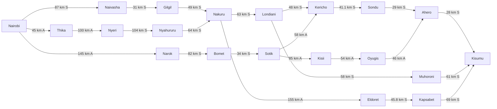
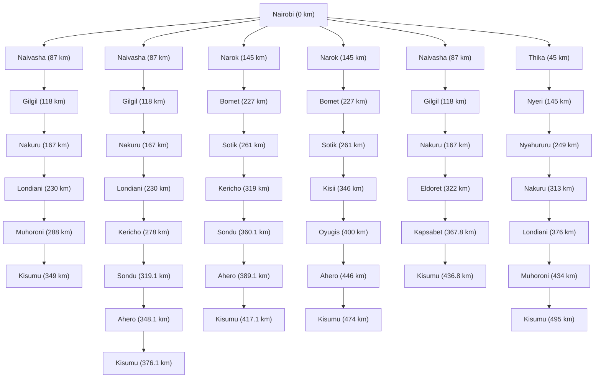

# ICS 3202 — Practical Exercise 3: Designing a Searching Agent

## Question 1: PEAS framework and environment

The self-driving trailer is a goal-based problem-solving agent that selects a route from Nairobi to Kisumu.

| PEAS | Application |
|---|---|
| Performance measure | Reach Kisumu safely, obey rules, minimise route distance |
| Environment | Highways, towns, traffic, other vehicles, weather and pedestrians |
| Actuators | Steering, braking, acceleration, lights and indicators |
| Sensors | GPS, cameras, radar/LiDAR, speed and proximity sensors |

The operating environment is **partially observable, stochastic, sequential, dynamic and continuous**. The route-search abstraction is discrete because towns and connections become individual states and actions.

## Question 2: Directed graph and search tree

**Goal formulation:** Nairobi is the initial state and Kisumu is the goal state. **Problem formulation:** states are towns; actions are directed travel links; the goal test is arrival in Kisumu; edge cost is road distance. **Abstraction:** discard minor junctions, traffic lights and lane-level detail and retain relevant towns and road links.

### Directed graph

S = published road-distance estimate previously collected; A = illustrative modeling assumption awaiting verification. Directed arcs show travel options in the model, not literal one-way roads.

### Search tree (route-path abstraction)

Repeated states are intentionally shown on separate branches because different paths may lead to the same town.

## Question 3: Path costs and shortest path

For a route, **total path cost = sum of the kilometre distances of its directed links**. Uniform-Cost Search/Dijkstra expands the smallest cumulative-cost frontier state.

### Distance table

| From | To | km | Status |
|---|---|---:|---|
| Nairobi | Naivasha | 87 | S |
| Naivasha | Gilgil | 31 | S |
| Gilgil | Nakuru | 49 | S |
| Nakuru | Londiani | 63 | S |
| Londiani | Kericho | 48 | S |
| Kericho | Sondu | 41.1 | S |
| Sondu | Ahero | 29 | S |
| Ahero | Kisumu | 28 | S |
| Londiani | Muhoroni | 58 | S |
| Muhoroni | Kisumu | 61 | S |
| Nairobi | Narok | 145 | A |
| Narok | Bomet | 82 | S |
| Bomet | Sotik | 34 | S |
| Sotik | Kericho | 58 | A |
| Sotik | Kisii | 85 | A |
| Kisii | Oyugis | 54 | A |
| Oyugis | Ahero | 46 | A |
| Nakuru | Eldoret | 155 | A |
| Eldoret | Kapsabet | 45.8 | S |
| Kapsabet | Kisumu | 69 | S |
| Nairobi | Thika | 45 | A |
| Thika | Nyeri | 100 | A |
| Nyeri | Nyahururu | 104 | S |
| Nyahururu | Nakuru | 64 | S |

### Candidate routes

| Route | Cost (km) |
|---|---:|
| Via Londiani–Muhoroni | 349 |
| Via Londiani–Kericho | 376.1 |
| Via Bomet–Kericho | 417.1 |
| Via Bomet–Kisii | 474 |
| Via Eldoret–Kapsabet | 436.8 |
| Via Central Highlands | 495 |

**Minimum for the defined illustrative directed graph: 349 km**, via Nairobi → Naivasha → Gilgil → Nakuru → Londiani → Muhoroni → Kisumu. Calculation: 87 + 31 + 49 + 63 + 58 + 61 = **349 km**. The comparison via Kericho gives 87 + 31 + 49 + 63 + 48 + 41.1 + 29 + 28 = **376.1 km**.

**Limitation:** These inputs combine previously collected published distance estimates with explicitly assumed distances and do not meet the exercise’s instruction to measure every edge in Google Maps. 
### Group Photograph

## Evidence of Groupwork

### Meeting Minutes — AI Practical Exercise 3

**Course:** ICS 3202 — Artificial Intelligence  
**Topic:** Designing a Searching Agent  
**Date:** Thursday, 15 October 2026  
**Time:** 5:45 PM – 6:12 PM  
**Venue:** Gazebo outside STMB, Strathmore University

### Members Present

| Student ID | Name |
|---|---|
| 168049 | Kipngeno Brian |
| 190119 | Sean Muthomi |
| 192085 | Alvin Kyalo |

### Agenda
1. Discuss the self-driving trailer agent and PEAS framework.
2. Develop the directed graph and search tree.
3. Evaluate possible routes from Nairobi to Kisumu.
4. Organize the assignment for GitHub submission.
5. AOB if theres any

### Discussion and Outcomes

1. **Agent Design:** Discussed the PEAS framework and classified the self-driving trailer's environment using the five environment characteristics.

2. **Graph and Search Tree:** Considered different highway routes from Nairobi to Kisumu, including routes through Nakuru, Kericho, Muhoroni, Narok and Eldoret. Also discussed the way to build the trees and graph and what to leave out 

3. **Route Optimization:** Discussed using road distances as path costs and applying a shortest-path search algorithm to identify the most suitable route.

4. **GitHub Submission:** Reviewed the requirement to prepare the assignment in `design.md` within the `PS-Agents` repository and ensure all members fork the repository.We also contemplated whether we should include all the processes thay we did when it came with making of the tables

### Conclusion

The group agreed to finalize the diagrams, review the route calculations and complete the GitHub submission requirements.
